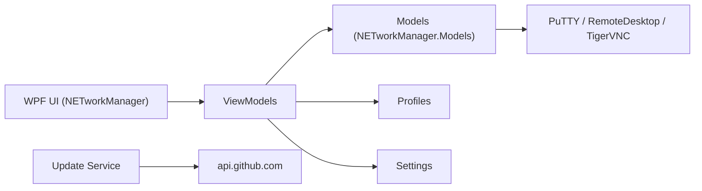

# BornToBeRoot/NETworkManager

> .NET desktop application that brings together network diagnostic tools and remote connections for administrators and homelab enthusiasts.

## The problem
Troubleshooting a network means juggling PuTTY, RDP, VNC, ping, traceroute, scanners and scattered hosts files.

## What it actually does
- Built-in remote connections: Remote Desktop, PuTTY (SSH, serial), PowerShell, TigerVNC.
- Diagnostics: WiFi Analyzer, IP and port scanner, Ping Monitor, traceroute, DNS Lookup, LLDP/CDP capture.
- Host and network profiles, with encryptable files, separable by client or environment.
- Enterprise deployment: MSI installer, signed binaries, system policies; 16+ languages.

## How it is wired


## Trying it
```powershell
choco install networkmanager
winget install BornToBeRoot.NETworkManager
```

## Cost and gotchas
Free, no ads. Optional third-party services, which can be enabled or not on first launch: api.github.com (updates), ipify.org, ip-api.com, speed.cloudflare.com. The IP and port scanners should be reserved for your own networks.

## What it is not
- Not a continuous monitoring tool: it is an interactive workstation.
- Windows only judging by WPF/UWP and the package managers cited (the README does not say so explicitly).
- GPL-3.0: copyleft for any modified redistribution.

## Alternatives
No alternative named in the README. It bundles PuTTY and TigerVNC rather than replacing them.

## For you
Adopt it if you administer machines from Windows: a single, free, maintained tool (recent push). Little direct link with data or ML.
