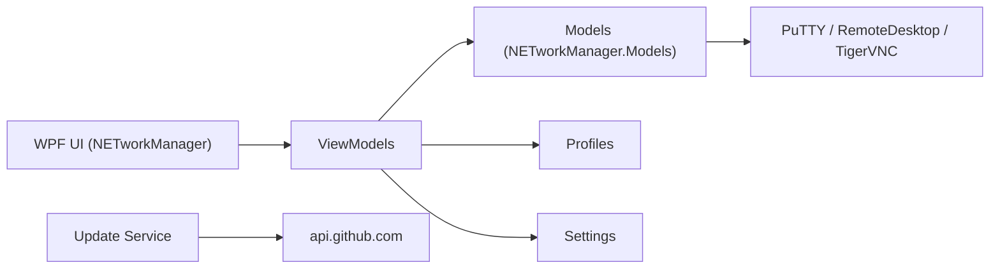

# BornToBeRoot/NETworkManager

> Application de bureau .NET qui réunit outils de diagnostic réseau et connexions distantes pour administrateurs et passionnés de homelab.

## Le problème
Dépanner un réseau oblige à jongler entre PuTTY, RDP, VNC, ping, traceroute, scanners et fichiers d'hôtes dispersés.

## Ce que ça fait vraiment
- Connexions distantes intégrées : Remote Desktop, PuTTY (SSH, série), PowerShell, TigerVNC.
- Diagnostic : WiFi Analyzer, scanner d'IP et de ports, Ping Monitor, traceroute, DNS Lookup, capture LLDP/CDP.
- Profils d'hôtes et réseaux, fichiers chiffrables, séparables par client ou environnement.
- Déploiement entreprise : installeur MSI, binaires signés, stratégies système ; 16+ langues.

## Comment c'est branché


## Essayer
```powershell
choco install networkmanager
winget install BornToBeRoot.NETworkManager
```

## Coût et pièges
Gratuit, sans publicité. Services tiers optionnels, activables ou non au premier lancement : api.github.com (mises à jour), ipify.org, ip-api.com, speed.cloudflare.com. Les scanners d'IP et de ports sont à réserver à ses propres réseaux.

## Ce que ce n'est pas
- Pas un outil de supervision continue : c'est un poste de travail interactif.
- Windows seulement d'après WPF/UWP et les gestionnaires de paquets cités (le README ne le dit pas explicitement).
- GPL-3.0 : copyleft pour toute redistribution modifiée.

## Alternatives
Aucune alternative nommée dans le README. Il intègre PuTTY et TigerVNC plutôt que de les remplacer.

## Pour toi
Adopter si tu administres des machines depuis Windows : outil unique, gratuit, maintenu (push récent). Peu de lien direct avec les données ou le ML.

