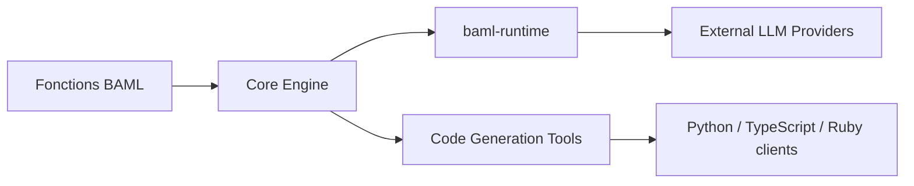

# BoundaryML/baml

> Typed language for writing agent and prompt functions, callable from Python, TypeScript, Go, etc.

## The problem
LLM prompts and outputs are fragile strings; you want types, tests and errors checked before execution.

## What it actually does
A language with TypeScript-like syntax, with types kept at runtime, typed errors, built-in tests and evaluations, and a standard library for agents. Usable on its own or adopted gradually: a BAML function is called from TS, Python, Go, C#, Java. The engine is in Rust, with a runtime and generated clients.

## How it is wired


## Trying it
```bash
brew install baml
baml agent install
baml init
baml ide install --code
```

## Cost and gotchas
Free, Apache-2.0; calls to LLM providers are billed by them. You have to learn a new language and its toolchain.

## What it is not
Not a simple prompt wrapper: a language with a compiler. The announced speed benchmarks have not been verified here.

## Alternatives
No alternative named in the README.

## For you
Keep an eye on it: interesting for making structured LLM outputs reliable, but a new language is a team commitment.
