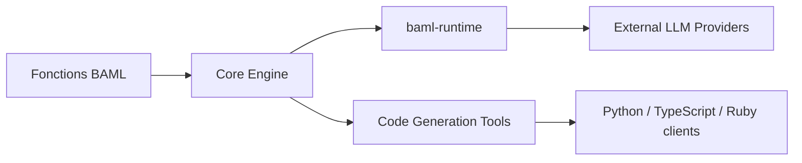

# BoundaryML/baml

> Langage typé pour écrire des fonctions d'agents et de prompts, appelable depuis Python, TypeScript, Go, etc.

## Le problème
Les prompts et sorties de LLM sont des chaînes fragiles ; on veut des types, des tests et des erreurs vérifiées avant l'exécution.

## Ce que ça fait vraiment
Un langage à la syntaxe proche de TypeScript, avec types conservés à l'exécution, erreurs typées, tests et évaluations intégrés, bibliothèque standard pour agents. Utilisable seul ou en adoption progressive : une fonction BAML est appelée depuis TS, Python, Go, C#, Java. Le moteur est en Rust, avec runtime et clients générés.

## Comment c'est branché


## Essayer
```bash
brew install baml
baml agent install
baml init
baml ide install --code
```

## Coût et pièges
Gratuit, Apache-2.0 ; les appels aux fournisseurs de LLM sont facturés par eux. Il faut apprendre un nouveau langage et sa chaîne d'outils.

## Ce que ce n'est pas
Pas un simple wrapper de prompts : un langage avec compilateur. Les benchmarks de vitesse annoncés ne sont pas vérifiés ici.

## Alternatives
Aucune alternative nommée dans le README.

## Pour toi
Surveiller : intéressant pour fiabiliser les sorties structurées de LLM, mais un nouveau langage est un engagement d'équipe.

