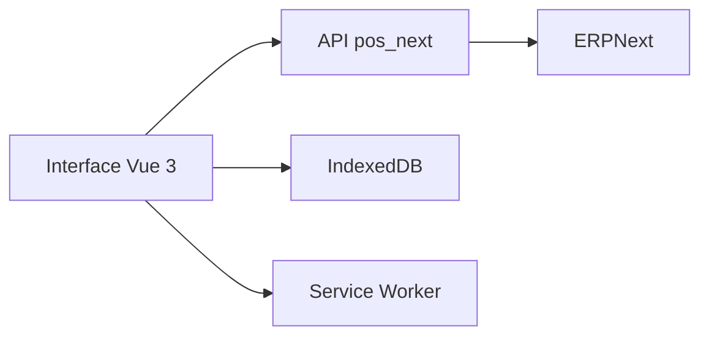

# BrainWise-DEV/POSNext

> Modern point-of-sale for ERPNext, built with Vue 3, with offline mode and promotions.

## The problem
ERPNext's native point of sale is considered limited for in-store selling: offline, promotions, split payments.

## What it actually does
Frappe/ERPNext v15 application rewritten in Vue 3 and Vite. Handles offline mode (IndexedDB, Service Worker), coupons and offers, gift cards, partial payments, returns, drafts and cash register shifts with reconciliation. Shortcuts: F4, F8, F9.

## How it is wired


## Trying it
```bash
cd ~/frappe-bench
bench get-app https://github.com/BrainWise-DEV/pos_next.git --branch version-15
bench --site [your-site-name] install-app pos_next
bench --site [your-site-name] migrate
bench build --app pos_next
```

## Cost and gotchas
Requires Frappe and ERPNext v15 or later. Use the `version-15` branch in production; `develop` is unstable. HTTPS is required for the Service Worker.

## What it is not
Not standalone software: it is an application for ERPNext. The README boasts about speed, with no measurements provided.

## Alternatives
No alternative named in the README.

## For you
Ignore: retail point-of-sale unrelated to data / AI / MLOps.
