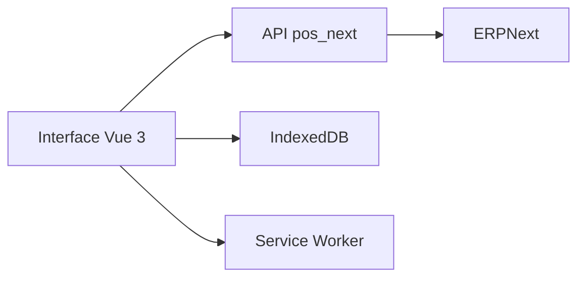

# BrainWise-DEV/POSNext

> Caisse enregistreuse moderne pour ERPNext, en Vue 3, avec mode hors ligne et promotions.

## Le problème
La caisse native d'ERPNext est jugée limitée pour la vente en magasin : hors ligne, promotions, paiements partagés.

## Ce que ça fait vraiment
Application Frappe/ERPNext v15 réécrite en Vue 3 et Vite. Gère le hors ligne (IndexedDB, Service Worker), les coupons et offres, les cartes cadeaux, les paiements partiels, les retours, les brouillons et les postes de caisse avec réconciliation. Raccourcis : F4, F8, F9.

## Comment c'est branché


## Essayer
```bash
cd ~/frappe-bench
bench get-app https://github.com/BrainWise-DEV/pos_next.git --branch version-15
bench --site [your-site-name] install-app pos_next
bench --site [your-site-name] migrate
bench build --app pos_next
```

## Coût et pièges
Exige Frappe et ERPNext v15 ou plus. Utiliser la branche `version-15` en production, `develop` est instable. HTTPS requis pour le Service Worker.

## Ce que ce n'est pas
Pas un logiciel autonome : c'est une application pour ERPNext. Le README vante la vitesse, sans mesure fournie.

## Alternatives
Aucune alternative nommée dans le README.

## Pour toi
À ignorer : caisse de vente au détail sans rapport avec data / IA / MLOps.

