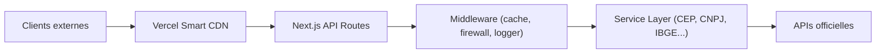

# BrasilAPI/BrasilAPI

> A free public REST API that centralizes Brazilian public data (CEP, CNPJ, banks...).

## The problem
Public information such as a CEP (postal code) is not accessible from a browser: the Correios API does not enable CORS.

## What it actually does
A Next.js project deployed on Vercel exposes API routes (v1, v2) and a GraphQL endpoint. Each service (banks, CEP, CNPJ, CPTEC weather, IBGE, FIPE, PIX, ISBN, Registro.br) calls the official source. A middleware chain handles cache, firewall, logging and errors. Vercel's CDN caches the responses.

## How it is wired

## Trying it
No command documented in the README: the OpenAPI documentation is given as a link, and the endpoints are called directly over HTTP.

## Cost and gotchas
Free, but the README forbids automated crawling: a telecom operator has already exceeded the quota five times by revalidating every CEP. The project describes itself as beta, with terms of use not yet written.

## What it is not
Not a database to download in bulk; not a guaranteed service (no SLA). The data remains that of the upstream sources, as slow or unstable as they are.

## Alternatives
No alternative named in the README.

## For you
To watch: a handy source of Brazilian public data for a prototype, but the maintenance quota and the absence of terms of use rule out making it a pipeline dependency.
