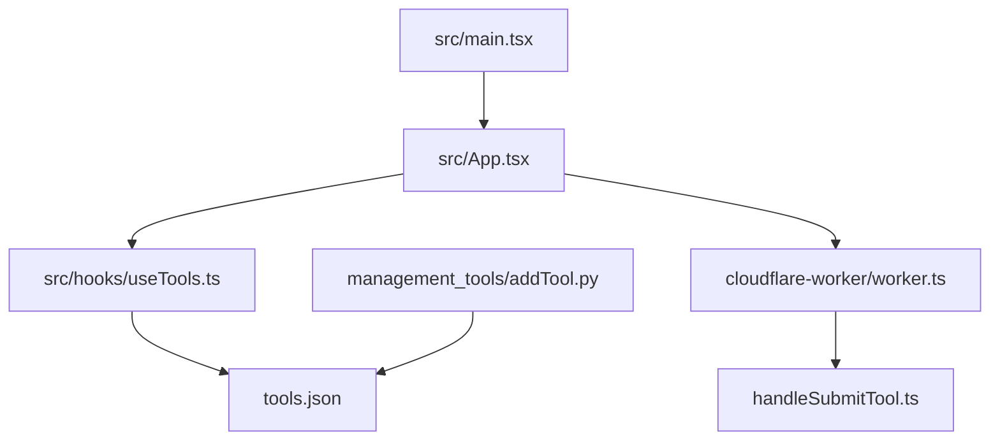

# BraveOPotato/FckSignups

> Directory of open source tools usable in the browser with no account, no email, and no tracking.

## The problem
Many free web tools force you to sign up before any use.

## What it actually does
A React + TypeScript site displays a `tools.json` catalog with category filters and cards. Submissions go through a Cloudflare Worker, and Python scripts add tools and update star counts. The README cites more than 200 tools and highlights the most original ones.

## How it is wired
Diagram based on the one provided.



## Trying it
```bash
git clone https://github.com/BraveOPotato/FckSignups.git && \
cd FckSignups && \
npm install && \
npm run dev
```

## Cost and gotchas
Free. The repository has 931 open issues, which suggests an influx of poorly tracked submissions. The stars and licenses of the listed tools are self-declared.

## What it is not
Not a tool in itself: it is a list, with an editorial choice openly admitted to be partial. Nothing proves that every tool really keeps the no-account promise.

## Alternatives
No alternative named in the README.

## For you
Worth watching: handy for finding a no-account utility, but the content is only as good as the submissions, so do not build it into a workflow.
