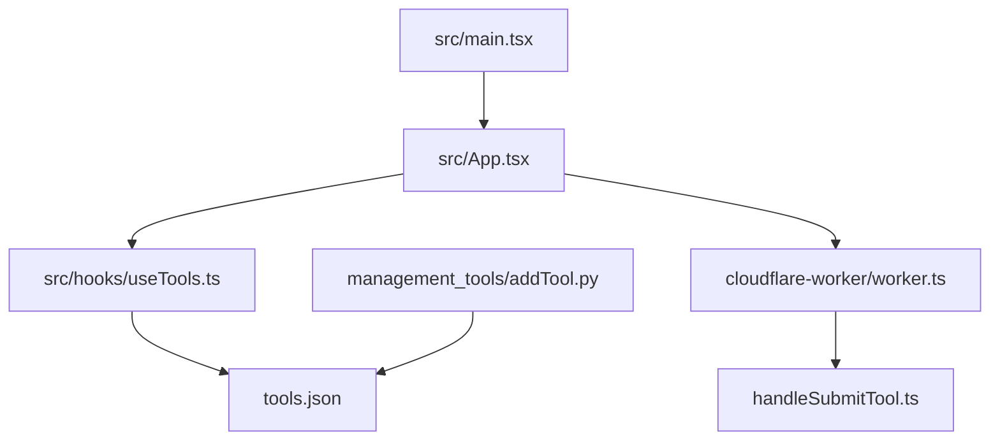

# BraveOPotato/FckSignups

> Annuaire d'outils open source utilisables dans le navigateur sans compte, ni e-mail, ni pistage.

## Le problème
Beaucoup d'outils web gratuits imposent une inscription avant le moindre usage.

## Ce que ça fait vraiment
Un site React + TypeScript affiche un catalogue `tools.json` avec filtres par catégorie et cartes. Les soumissions passent par un Cloudflare Worker, et des scripts Python ajoutent des outils et mettent à jour les étoiles. Le README cite plus de 200 outils et met en avant les plus originaux.

## Comment c'est branché
Schéma d'après le diagramme fourni.



## Essayer
```bash
git clone https://github.com/BraveOPotato/FckSignups.git && \
cd FckSignups && \
npm install && \
npm run dev
```

## Coût et pièges
Gratuit. Le dépôt a 931 issues ouvertes, ce qui laisse penser à un afflux de soumissions mal suivies. Les étoiles et licences des outils listés sont déclaratives.

## Ce que ce n'est pas
Pas un outil en soi : c'est une liste, avec un choix éditorial assumé comme partial. Rien ne prouve que chaque outil respecte vraiment la promesse sans compte.

## Alternatives
Aucune alternative nommée dans le README.

## Pour toi
À surveiller : pratique pour trouver un utilitaire sans compte, mais le contenu vaut ce que valent les soumissions, donc ne l'intègre pas à une chaîne de travail.

