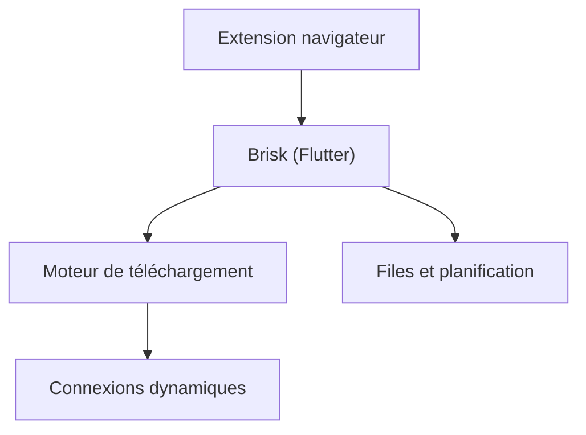

# BrisklyDev/brisk

> Desktop download manager with its own multi-connection engine, for everyone.

## The problem
Browsers often download over a single connection and handle segmented video streams poorly.

## What it actually does
The engine is written in Dart with the http package, without aria2. It starts with one connection then adds more on the fly, reuses freed connections and resets those that freeze. It handles queues, scheduling, a shortcut to paste a URL and M3U8 stream capture via a separate browser extension.

## How it is wired
Simplified diagram based on the sheet, no diagram supplied.



## Trying it
```bash
flutter build macos|windows|linux
```
The README gives this single command, with Flutter SDK 3.32.0.

## Cost and gotchas
Free. On Linux, the keybinder-3 and appindicator3 libraries are required for the tarball archive. On Windows, a SmartScreen warning is possible.

## What it is not
Not a scraping tool: it is a download manager. The browser extension is a separate repository.

## Alternatives
The README cites aria2 as an engine that Brisk does not use.

## For you
Ignore: general-purpose utility, unrelated to a data / AI workflow.
