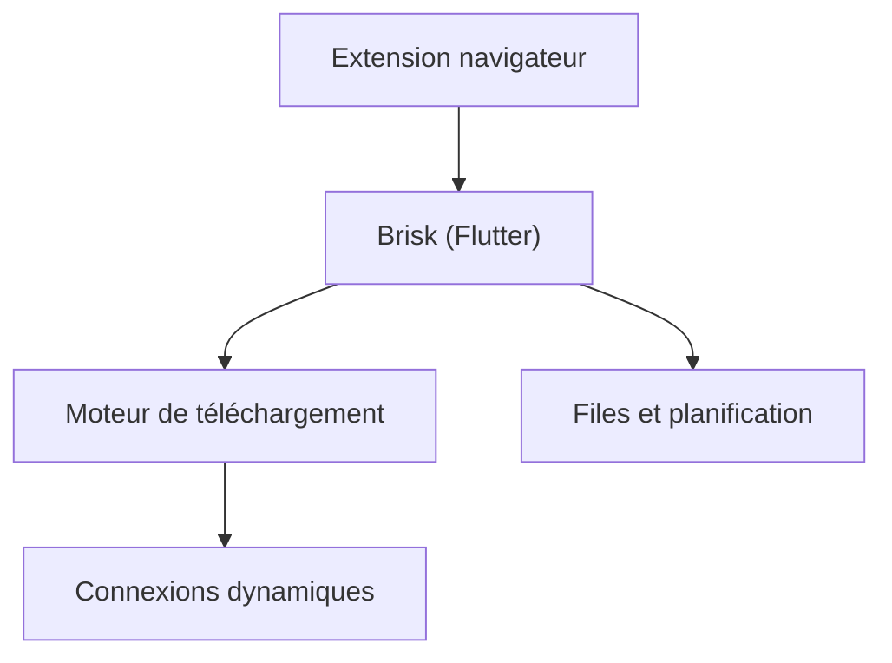

# BrisklyDev/brisk

> Gestionnaire de téléchargements de bureau avec son propre moteur multi-connexion, pour tout public.

## Le problème
Les navigateurs téléchargent souvent sur une seule connexion et gèrent mal les flux vidéo segmentés.

## Ce que ça fait vraiment
Le moteur est écrit en Dart avec le paquet http, sans aria2. Il démarre avec une connexion puis en ajoute à la volée, réutilise les connexions libérées et réinitialise celles qui se figent. Il gère files d'attente, planification, raccourci pour coller une URL et capture de flux M3U8 via une extension de navigateur séparée.

## Comment c'est branché
Schéma simplifié d'après la fiche, sans diagramme fourni.



## Essayer
```bash
flutter build macos|windows|linux
```
Le README donne cette seule commande, avec Flutter SDK 3.32.0.

## Coût et pièges
Gratuit. Sous Linux, bibliothèques keybinder-3 et appindicator3 requises pour l'archive tarball. Sous Windows, avertissement SmartScreen possible.

## Ce que ce n'est pas
Ce n'est pas un outil de scraping : c'est un gestionnaire de téléchargements. L'extension navigateur est un dépôt à part.

## Alternatives
Le README cite aria2 comme moteur que Brisk n'utilise pas.

## Pour toi
À ignorer : utilitaire généraliste, sans lien avec un flux data / IA.

