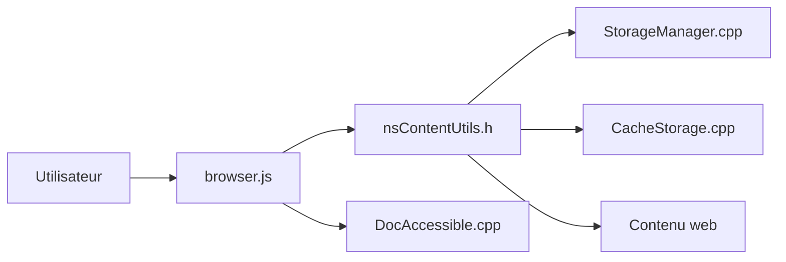

# BrowserWorks/waterfox

> Customizable browser derived from Mozilla Firefox, full platform source code.

## The problem
Users want a Firefox browser with their own customization and packaging, without depending on the official distribution.

## What it actually does
The repository contains the Mozilla platform code, the Waterfox product code, the branding, features, packaging and release files. The README only documents building with the Mozilla build system (`./mach`). The architecture described shows the browser interface, the DOM, storage, media and accessibility.

## How it is wired


## Trying it
```bash
./mach bootstrap
./mach build
./mach package
./mach test --auto
```

## Cost and gotchas
Free. Building Firefox requires a lot of disk, RAM and time (not quantified in the README). The license is present but not identified by GitHub: to be checked.

## What it is not
Not a lightweight application to contribute to: it is a fork of the entire Mozilla platform. The README is very short and describes neither features nor differences from Firefox.

## Alternatives
Firefox: upstream base, documented by the Firefox Source Docs.

## For you
Ignore: a browser brings nothing to data/AI/MLOps work, and the repository is huge to build.
