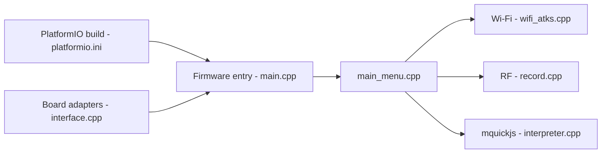

# BruceDevices/firmware

> ESP32 firmware of offensive security tools (Wi-Fi, BLE, RF, RFID, IR) for Red Team crews.

## The problem
Commercial portable offensive tools are expensive and not very modular.

## What it actually does
C++ firmware for ESP32 (M5Stack, LILYGO, Elecrow, etc.) with an embedded menu, serial commands, web interface, ESP-NOW. Modules: Wi-Fi attacks (deauth, evil portal, ARP), BLE spam, Sub-GHz/CC1101, RFID/NFC, IR, NRF24, BadUSB, JavaScript interpreter (mquickjs). A house board (RF REAPER) is sold.

## How it is wired


## Trying it
```bash
esptool.py --port /dev/ttyACM0 write_flash 0x00000 Bruce-<device>.bin
```
Alternative: web flasher at bruce.computer/flasher.

## Cost and gotchas
Compatible ESP32 hardware to buy. Legal and authorized use only (README clause); several features are active attacks.

## What it is not
Not a data analysis tool; the README specifies that some features (Emulate tag, Mousejack, FM spectrum) are not checked off.

## Alternatives
Flipper Zero is cited as a point of comparison (more expensive device).

## For you
Ignore for a data/AI/MLOps profile: hardware pentest tool, unrelated to your work.
