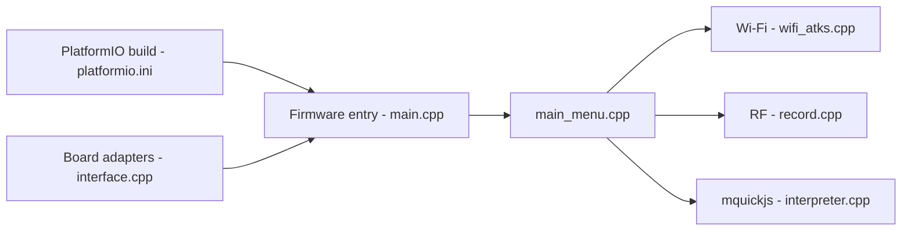

# BruceDevices/firmware

> Firmware ESP32 d'outils de sécurité offensive (Wi-Fi, BLE, RF, RFID, IR) pour équipes Red Team.

## Le problème
Les outils offensifs portables du commerce sont chers et peu modulables.

## Ce que ça fait vraiment
Firmware C++ pour ESP32 (M5Stack, LILYGO, Elecrow, etc.) avec menu embarqué, commandes série, interface web, ESP-NOW. Modules : attaques Wi-Fi (deauth, evil portal, ARP), BLE spam, Sub-GHz/CC1101, RFID/NFC, IR, NRF24, BadUSB, interpréteur JavaScript (mquickjs). Une carte maison (RF REAPER) est vendue.

## Comment c'est branché


## Essayer
```bash
esptool.py --port /dev/ttyACM0 write_flash 0x00000 Bruce-<device>.bin
```
Alternative : web flasher sur bruce.computer/flasher.

## Coût et pièges
Matériel ESP32 compatible à acheter. Usage légal et autorisé uniquement (clause du README) ; plusieurs fonctions sont des attaques actives.

## Ce que ce n'est pas
Pas un outil d'analyse de données ; le README précise que certaines fonctions (Emulate tag, Mousejack, FM spectrum) ne sont pas cochées.

## Alternatives
Flipper Zero est cité comme point de comparaison (appareil plus cher).

## Pour toi
À ignorer pour un profil data/IA/MLOps : outil de pentest matériel, sans lien avec ton métier.

