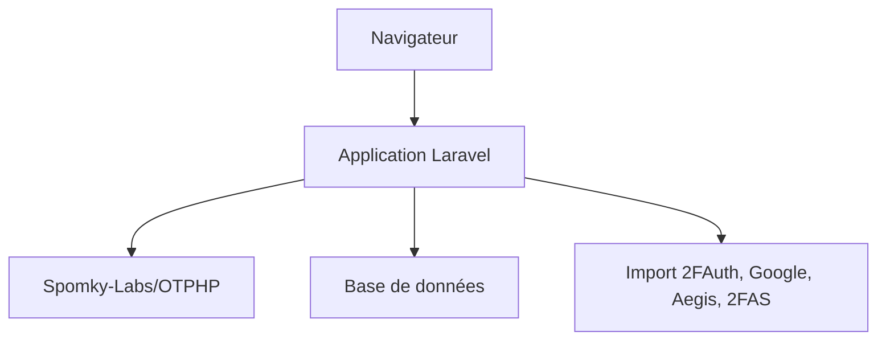

# Bubka/2FAuth

> Self-hosted web application that replaces Google Authenticator to generate your one-time codes.

## The problem
Authenticator apps show all the codes at once and live on a phone whose loss wipes everything.

## What it actually does
2FAuth stores your 2FA accounts in a database that you back up. It generates TOTP, HOTP and Steam Guard codes according to RFC 4226 and 6238, reads QR codes and sorts accounts into groups. It supports multiple users, login with a security key, optional database encryption and automatic logout. Imports: 2FAuth, Google Auth, Aegis, 2FAS.

## How it is wired
Simplified diagram based on the sheet, no diagram provided.


## Trying it
```bash
# Aucune commande dans le README : il renvoie aux guides d'installation (serveur, Docker, Heroku).
```

## Cost and gotchas
Free, but you host it yourself: PHP and a Laravel-compatible database, or Docker. Encryption is disabled by default; with it, back up the `APP_KEY` value, otherwise the data is lost. The public demo displays its credentials, do not enter real accounts there.

## What it is not
Not a password manager. Putting all your codes in a single web database creates a point of failure to protect.

## Alternatives
No alternative named in the README (Google Authenticator is cited as a point of comparison, not as a repository).

## For you
Ignore: useful personally if you want to host your codes, but unrelated to your work.
