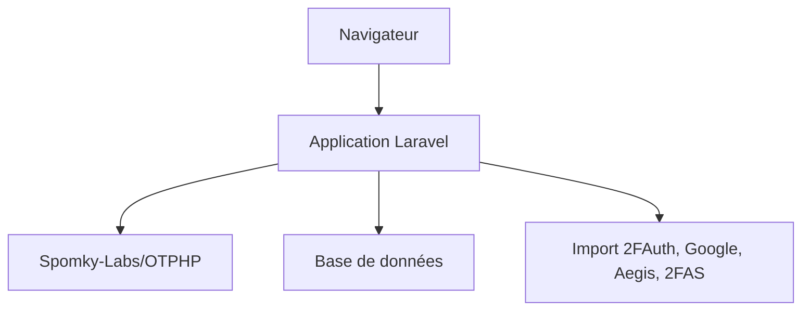

# Bubka/2FAuth

> Application web auto-hébergée qui remplace Google Authenticator pour générer tes codes à usage unique.

## Le problème
Les applications d'authentification affichent tous les codes à la fois et vivent sur un téléphone dont la perte efface tout.

## Ce que ça fait vraiment
2FAuth stocke tes comptes 2FA dans une base que tu sauvegardes. Il génère des codes TOTP, HOTP et Steam Guard selon les RFC 4226 et 6238, lit les QR codes et classe les comptes en groupes. Il gère plusieurs utilisateurs, une connexion par clé de sécurité, un chiffrement facultatif de la base et la déconnexion automatique. Imports : 2FAuth, Google Auth, Aegis, 2FAS.

## Comment c'est branché
Schéma simplifié d'après la fiche, sans diagramme fourni.


## Essayer
```bash
# Aucune commande dans le README : il renvoie aux guides d'installation (serveur, Docker, Heroku).
```

## Coût et pièges
Gratuit, mais à héberger toi-même : PHP et une base compatible Laravel, ou Docker. Le chiffrement est désactivé par défaut ; avec lui, sauvegarde la valeur `APP_KEY`, sinon les données sont perdues. La démo publique affiche ses identifiants, ne pas y saisir de vrais comptes.

## Ce que ce n'est pas
Ce n'est pas un gestionnaire de mots de passe. Mettre tous tes codes dans une seule base web crée un point de défaillance à protéger.

## Alternatives
Aucune alternative nommée dans le README (Google Authenticator est cité comme point de comparaison, pas comme dépôt).

## Pour toi
À ignorer : utile à titre personnel si tu veux héberger tes codes, mais sans rapport avec ton métier.

