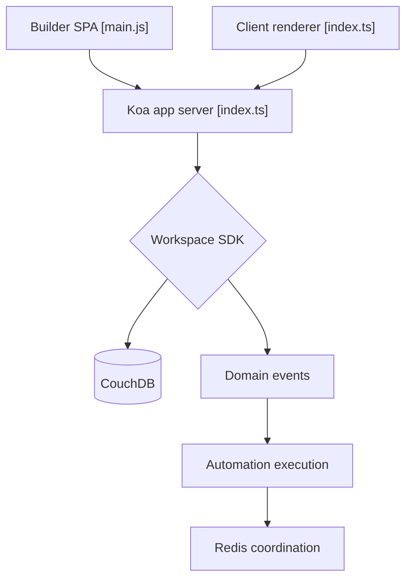

# Budibase/budibase

> An open source platform for building internal applications, automations and AI agents.

## The problem
Operations teams depend on scattered tools for requests, approvals and workflows, and engineers repeatedly code internal interfaces.

## What it actually does
A Svelte editor for applications connected to databases and APIs, event-triggered automations, and AI agents (tools, knowledge bases, RAG, model routing via LiteLLM). A public OpenAPI API is exposed. Storage on CouchDB, Redis and S3-compatible object storage.

## How it is wired


## Trying it
The README lists hosting options (Docker, Docker Compose, Kubernetes, Digital Ocean, Portainer) without giving a command.
```bash
# aucune commande documentée dans le README fourni
```

## Cost and gotchas
Self-hosting on your own infrastructure; paid cloud as an option. The AI features require a configured external model. Several services to operate (CouchDB, Redis, MinIO).

## What it is not
Not a data/AI tool in the strict sense: an internal-application builder. License not identified by GitHub. The README's marketing claims (hundreds of hours saved) are not measured.

## Alternatives
None named in the README.

## For you
Worth watching: handy for internal interfaces around your agents, but the stack to operate is heavy and the license remains to be checked.
