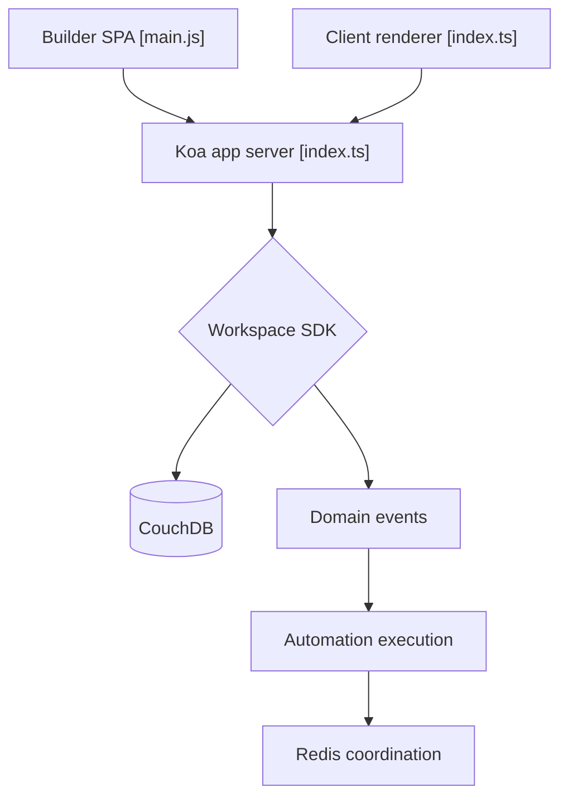

# Budibase/budibase

> Plateforme open source pour construire des applications internes, automatisations et agents IA.

## Le problème
Les équipes opérationnelles dépendent d'outils dispersés pour demandes, validations et workflows, et les ingénieurs codent des interfaces internes à répétition.

## Ce que ça fait vraiment
Éditeur Svelte d'applications branchées à des bases de données et API, automatisations déclenchées par événements, et agents IA (outils, bases de connaissances, RAG, routage de modèles via LiteLLM). Une API publique OpenAPI est exposée. Stockage CouchDB, Redis et objet compatible S3.

## Comment c'est branché


## Essayer
Le README liste des options d'hébergement (Docker, Docker Compose, Kubernetes, Digital Ocean, Portainer) sans donner de commande.
```bash
# aucune commande documentée dans le README fourni
```

## Coût et pièges
Auto-hébergement sur ta propre infrastructure ; cloud payant en option. Les fonctions IA demandent un modèle externe configuré. Plusieurs services à opérer (CouchDB, Redis, MinIO).

## Ce que ce n'est pas
Pas un outil data/IA au sens strict : un générateur d'applications internes. Licence non identifiée par GitHub. Les affirmations marketing du README (centaines d'heures économisées) ne sont pas mesurées.

## Alternatives
Aucune nommée dans le README.

## Pour toi
À surveiller : pratique pour des interfaces internes autour de tes agents, mais la pile à opérer est lourde et la licence reste à vérifier.

