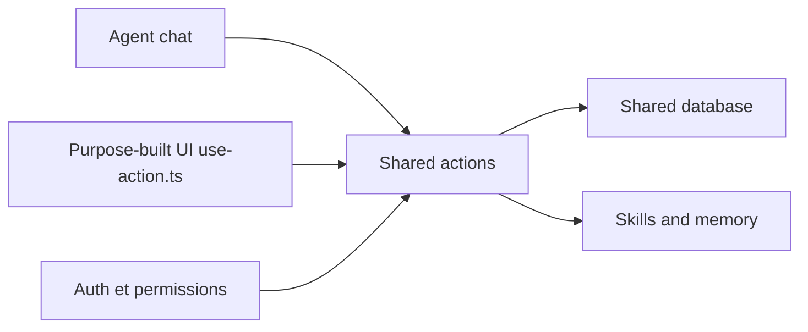

# BuilderIO/agent-native

> TypeScript framework where one action serves the agent, the UI and the APIs, for product teams.

## The problem
In an agent app, logic is often written twice: once for the UI, once for the agent's tools, with permissions that diverge.

## What it actually does
You define a capability once with `defineAction` (zod schema, handler). The agent receives it as a tool; React calls it via `useActionQuery`; it is also exposed over HTTP, MCP, A2A and CLI. Provides chat, authentication, skills and memory, automations, agent teams, PostgreSQL (PGlite locally). Example apps: Mail, Slides, Calendar.

## How it is wired


## Trying it
```bash
npx --yes @agent-native/core@latest create my-agent --standalone --template chat
```

## Cost and gotchas
The framework is free; the model of your choice is at your expense. PostgreSQL in production.

## What it is not
Not a simple LLM SDK: it imposes an application structure. The cited agent engine (`builder-engine.ts`) hints at a link with the Builder.io ecosystem, not specified.

## Alternatives
No alternative named in the README.

## For you
Worth watching: the "one action, several surfaces" idea is useful for internal data-team tools; wait for more hindsight before building a product on it.
