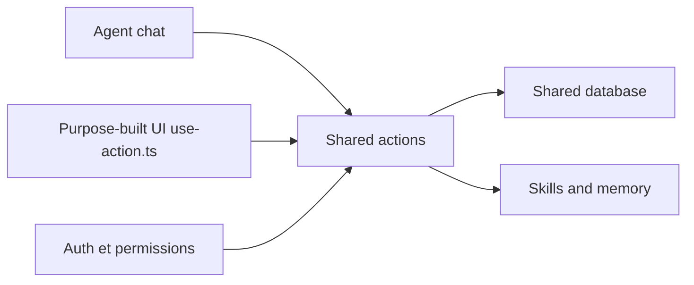

# BuilderIO/agent-native

> Framework TypeScript où une même action sert l'agent, l'interface et les API, pour équipes produit.

## Le problème
Dans une appli à agent, la logique est souvent écrite deux fois : une pour l'interface, une pour les outils de l'agent, avec des permissions qui divergent.

## Ce que ça fait vraiment
On définit une capacité une fois avec `defineAction` (schéma zod, handler). L'agent la reçoit comme outil ; React l'appelle via `useActionQuery` ; elle est aussi exposée en HTTP, MCP, A2A et CLI. Fournit chat, authentification, compétences et mémoire, automatisations, équipes d'agents, PostgreSQL (PGlite en local). Des applications d'exemple : Mail, Slides, Calendar.

## Comment c'est branché


## Essayer
```bash
npx --yes @agent-native/core@latest create my-agent --standalone --template chat
```

## Coût et pièges
Le framework est gratuit ; le modèle de ton choix est à ta charge. PostgreSQL en production.

## Ce que ce n'est pas
Pas un simple SDK de LLM : il impose une structure d'application. Le moteur d'agent cité (`builder-engine.ts`) laisse penser à un lien avec l'écosystème Builder.io, non précisé.

## Alternatives
Aucune alternative nommée dans le README.

## Pour toi
À surveiller : l'idée « une action, plusieurs surfaces » est utile pour des outils internes d'équipe data ; attends davantage de recul avant d'y bâtir un produit.

