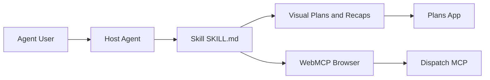

# BuilderIO/skills

> Catalogue of installable agent skills: visual plans, PR reviews, autonomy guardrails.

## The problem
Coding agents lack shared routines to plan, review, bound their usage and verify their work.

## What it actually does
Each skill is a `SKILL.md` invoked by a command (`/visual-plan`, `/visual-recap`, `/agent-watchdog`, `/plan-arbiter`, `/quick-recap`, `/stay-within-limits`…). The Factory module, experimental, turns feedback and telemetry into policy-governed changes. Several skills rely on Agent-Native applications or Clips Desktop.

## How it is wired


## Trying it
```bash
npx @agent-native/skills@latest add
npx @agent-native/skills@latest add --skill quick-recap
/plugin marketplace add BuilderIO/skills
/plugin install builder-skills@builder-skills
```

## Cost and gotchas
Free, but plans shared by link go through a hosted app; a local mode exists. `/rewind` requires macOS and the Clips Desktop app. Repository created in June 2026: young.

## What it is not
Not a code library: these are instructions for agents. Factory does not create the integrations or the schedules.

## Alternatives
- Vercel skills: `npx skills@latest add BuilderIO/skills`, simple copy of the folders, without the `AGENTS.md` blocks.

## For you
Worth watching: a few skills (`/read-the-damn-docs`, `/stay-within-limits`) are worth copying into your Claude Code workflow; the rest depends on a third-party ecosystem.
