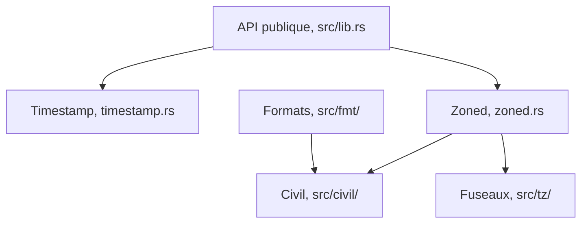

# BurntSushi/jiff

> Rust date and time zone library designed to be hard to misuse.

## The problem
Date calculations with time zones and daylight saving time easily produce silent errors in existing libraries.

## What it actually does
Jiff provides high-level types (`Timestamp`, `Zoned`, `Span`), daylight-saving-aware arithmetic and rounding. It reads the IANA time zone database, parses and prints losslessly (RFC 3339, RFC 2822, strftime), with optional Serde. Inspired by Temporal (TC39). Platforms: Unix, Windows, Android, WASM.

## How it is wired


## Trying it
```bash
cargo new jiff-example
cd jiff-example
cargo add jiff
cargo run
```

## Cost and gotchas
Free, but it requires the Rust toolchain (compiler 1.85.0 minimum), which is missing from the prerequisites list. License Unlicense or MIT. Performance comes after API correctness.

## What it is not
It is not a Python module or a data tool: it is a Rust building block. The README acknowledges some unoptimized areas.

## Alternatives
`chrono`, `time`, `hifitime` and `icu`, compared in the repository documentation.

## For you
Ignore unless you have a Rust project: for a Python data profile, no direct gain.
