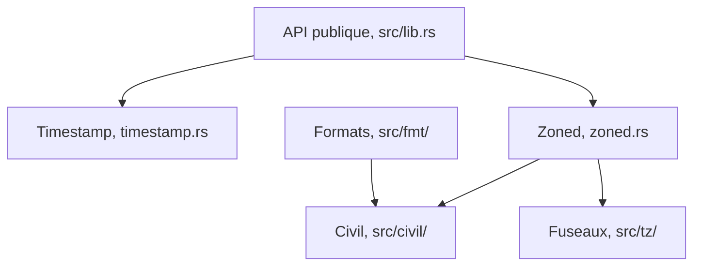

# BurntSushi/jiff

> Bibliothèque Rust de dates et fuseaux horaires conçue pour être difficile à mal utiliser.

## Le problème
Les calculs de dates avec fuseaux et heure d'été produisent facilement des erreurs silencieuses dans les bibliothèques existantes.

## Ce que ça fait vraiment
Jiff fournit des types haut niveau (`Timestamp`, `Zoned`, `Span`), une arithmétique consciente de l'heure d'été et des arrondis. Il lit la base IANA des fuseaux, analyse et imprime sans perte (RFC 3339, RFC 2822, strftime), avec Serde en option. Inspiré de Temporal (TC39). Plateformes : Unix, Windows, Android, WASM.

## Comment c'est branché


## Essayer
```bash
cargo new jiff-example
cd jiff-example
cargo add jiff
cargo run
```

## Coût et pièges
Gratuit, mais il faut la chaîne Rust (compilateur 1.85.0 minimum), absente de la liste des prérequis. Licence Unlicense ou MIT. Les performances viennent après la justesse de l'API.

## Ce que ce n'est pas
Ce n'est pas un module Python ni un outil de données : c'est une brique Rust. Le README reconnaît des zones non optimisées.

## Alternatives
`chrono`, `time`, `hifitime` et `icu`, comparés dans la documentation du dépôt.

## Pour toi
À ignorer sauf projet Rust : pour un profil data en Python, aucun gain direct.

