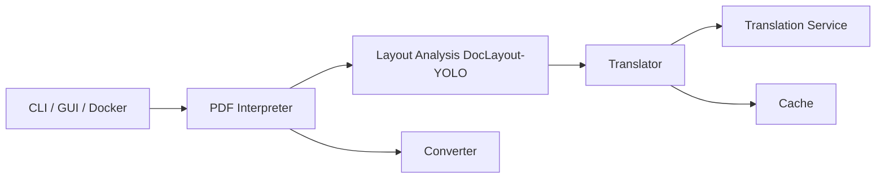

# Byaidu/PDFMathTranslate

> Translates scientific PDFs while preserving formulas, figures and layout, via CLI, GUI or Docker.

## The problem
Reading a paper in a foreign language without losing the equations or the original format.

## What it actually does
`pdf2zh` analyzes the layout with DocLayout-YOLO (ONNX), translates paragraphs through a service of your choice (Google by default, DeepL, OpenAI…) and rewrites the PDF, producing a monolingual and a bilingual version. Options: partial pages, cache, MCP mode, BabelDOC backend, experimental OCR. The README states that version 2.0 lives in another repository.

## How it is wired


## Trying it
```bash
pip install uv
uv tool install --python 3.12 pdf2zh
pdf2zh document.pdf
pdf2zh -i
docker run -d -p 7860:7860 byaidu/pdf2zh
```

## Cost and gotchas
The default Google service needs no key; the others (OpenAI, DeepL) require a key. A model is downloaded from Hugging Face (mirror possible). Python 3.11 to 3.12 only.

## What it is not
Not the repository of version 2.0 (PDFMathTranslate-next, reserved for development). PDFs are sent to the chosen translation service.

## Alternatives
- PDFMathTranslate-next: a more complete fork, not designed for contributions.
- BabelDOC: experimental backend cited.

## For you
Adopt it to read research papers: one-command installation, immediate result, provided you accept sending the text to a translation service.
