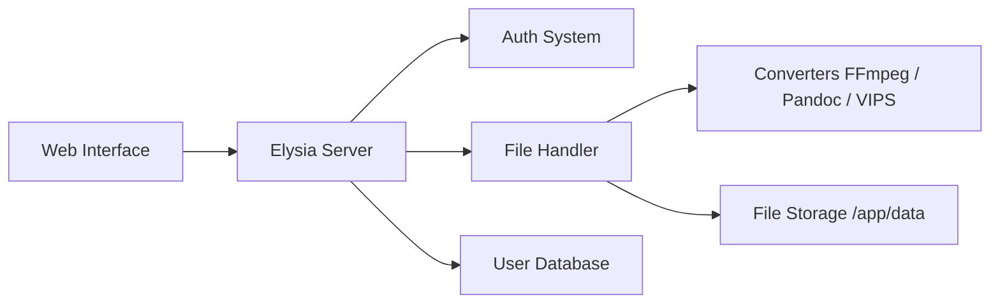

# C4illin/ConvertX

> Self-hosted file converter, over a thousand formats, with accounts and batch processing.

## The problem
Converting documents, images, audio, video or 3D models means juggling command-line tools or third-party websites.

## What it actually does
Web application (TypeScript, Bun, Elysia) that routes each file to a converter: FFmpeg, Pandoc, Calibre, GraphicsMagick, Inkscape, VIPS, XeLaTeX, Assimp, LibJXL, Resvg. Multi-account, JWT authentication, automatic file deletion (24 h by default), history.

## How it is wired


## Trying it
```bash
docker run -p 3000:3000 -e PUID=1000 -e PGID=1000 -v ./data:/app/data ghcr.io/c4illin/convertx
```
Then `http://localhost:3000`.

## Cost and gotchas
Free. Set `JWT_SECRET`, align `PUID/PGID`. Never expose it with `ALLOW_UNAUTHENTICATED` or `ACCOUNT_REGISTRATION`; the first person to arrive creates the first account. AGPL-3.0.

## What it is not
Not a service for the open internet (README). Which conversions work depends on the bundled tools.

## Alternatives
No alternative named in the README.

## For you
Handy for converting sets of files internally (images, PDF, audio) before a pipeline; worth watching, no urgency.
