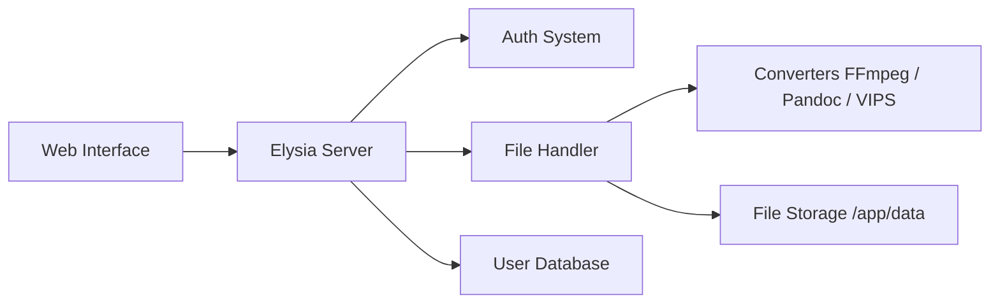

# C4illin/ConvertX

> Convertisseur de fichiers auto-hébergé, plus d'un millier de formats, avec comptes et traitement par lots.

## Le problème
Convertir documents, images, audio, vidéo ou modèles 3D oblige à jongler entre outils en ligne de commande ou sites tiers.

## Ce que ça fait vraiment
Application web (TypeScript, Bun, Elysia) qui route chaque fichier vers un convertisseur : FFmpeg, Pandoc, Calibre, GraphicsMagick, Inkscape, VIPS, XeLaTeX, Assimp, LibJXL, Resvg. Multi-comptes, authentification JWT, suppression automatique des fichiers (24 h par défaut), historique.

## Comment c'est branché


## Essayer
```bash
docker run -p 3000:3000 -e PUID=1000 -e PGID=1000 -v ./data:/app/data ghcr.io/c4illin/convertx
```
Puis `http://localhost:3000`.

## Coût et pièges
Gratuit. Fixer `JWT_SECRET`, aligner `PUID/PGID`. Ne jamais exposer avec `ALLOW_UNAUTHENTICATED` ou `ACCOUNT_REGISTRATION` ; le premier venu crée le premier compte. AGPL-3.0.

## Ce que ce n'est pas
Pas un service pour internet ouvert (README). Quelle conversion fonctionne dépend des outils embarqués.

## Alternatives
Aucune alternative nommée dans le README.

## Pour toi
Pratique pour convertir des jeux de fichiers en interne (images, PDF, audio) avant un pipeline ; à surveiller, sans urgence.

