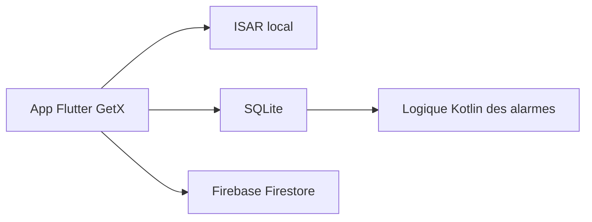

# CCExtractor/ultimate_alarm_clock

> Flutter alarm clock app with smart cancellation, challenges, shared alarms and profiles.

## The problem
A regular alarm clock rings even when you are already up, and is too easy to switch off.

## What it actually does
Alarm clock with cancellation based on phone activity, the weather (Open-Meteo) or location, and wake-up challenges: shaking, QR code, math. Shareable alarms and profiles, a Guardian Angel that calls or sends an SMS, timers, Google Calendar integration. Storage in Firestore, ISAR and SQLite; alarm logic in Kotlin.

## How it is wired
Simplified diagram based on the sheet, no diagram provided.



## Trying it
```bash
git clone https://github.com/CCExtractor/ultimate_alarm_clock.git
cd ultimate_alarm_clock
flutter pub get
flutter run
```

## Cost and gotchas
Free. Alarm sharing goes through a Google login and Firebase. The README mentions a Gradle failure: Flutter 3.22.2, Android Studio Koala and Java 17 are recommended. 105 open issues.

## What it is not
Not an alarm clock ready to install from a store: the README describes a build from source. Last push in June 2026, new features mentioned date from GSoC 2024.

## Alternatives
No alternative named in the README.

## For you
Ignore: consumer mobile app, unrelated to data, AI or MLOps.
