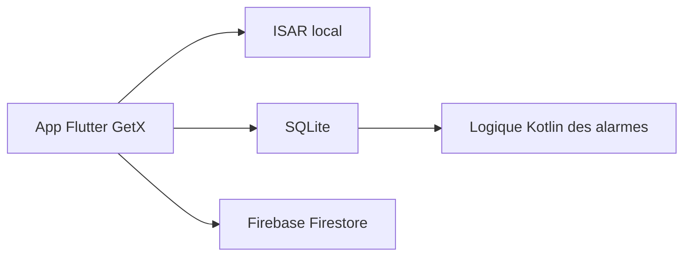

# CCExtractor/ultimate_alarm_clock

> Application Flutter de réveil avec annulation intelligente, défis, alarmes partagées et profils.

## Le problème
Un réveil classique sonne même quand tu es déjà debout, et se coupe trop facilement.

## Ce que ça fait vraiment
Réveil avec annulation selon l'activité du téléphone, la météo (Open-Meteo) ou le lieu, et défis pour se réveiller : secousses, QR code, calcul. Alarmes et profils partageables, Guardian Angel qui appelle ou envoie un SMS, minuteurs, intégration Google Calendar. Stockage Firestore, ISAR et SQLite ; logique d'alarme en Kotlin.

## Comment c'est branché
Schéma simplifié d'après la fiche, sans diagramme fourni.



## Essayer
```bash
git clone https://github.com/CCExtractor/ultimate_alarm_clock.git
cd ultimate_alarm_clock
flutter pub get
flutter run
```

## Coût et pièges
Gratuit. Le partage d'alarmes passe par une connexion Google et Firebase. Le README signale un échec Gradle : Flutter 3.22.2, Android Studio Koala et Java 17 recommandés. 105 issues ouvertes.

## Ce que ce n'est pas
Pas un réveil prêt à installer depuis un magasin : le README décrit un build depuis les sources. Dernier push en juin 2026, nouveautés citées datant de GSoC 2024.

## Alternatives
Aucune alternative nommée dans le README.

## Pour toi
Ignorer : application mobile grand public, sans rapport avec la data, l'IA ou le MLOps.

