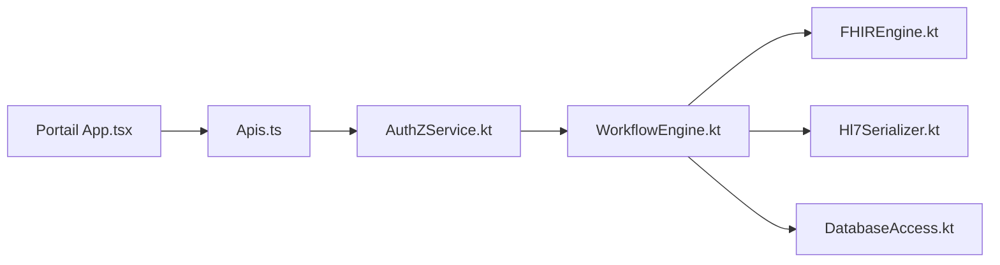

# CDCgov/prime-reportstream

> CDC platform that receives, processes and routes public health reports to health departments.

## The problem
Laboratories send their results in varied formats; health authorities receive them late and poorly.

## What it actually does
Report submission, workflow and FHIR engines in Kotlin, HL7 serialization, database, blob storage, history, React portal (deliveries, message tracking, dashboard, administration). The initial focus is the delivery of COVID-19 tests.

## How it is wired

## Trying it
No command in the README: see the backend and frontend getting-started guides.

## Cost and gotchas
Archived repository (last push May 2026), 1,261 open issues. No longer receives updates.

## What it is not
Not a product to deploy: archived and tied to a US government context.

## Alternatives
PRIME SimpleReport (sister project for rapid tests, cited).

## For you
Ignore: archived; only the educational interest of a public health HL7/FHIR pipeline remains.
