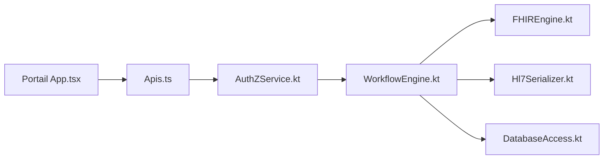

# CDCgov/prime-reportstream

> Plateforme du CDC qui reçoit, traite et achemine des rapports de santé publique vers les départements de santé.

## Le problème
Les laboratoires envoient leurs résultats dans des formats variés ; les autorités sanitaires les reçoivent tard et mal.

## Ce que ça fait vraiment
Soumission de rapports, moteurs de workflow et FHIR en Kotlin, sérialisation HL7, base de données, stockage blob, historique, portail React (livraisons, suivi des messages, tableau de bord, administration). Le focus initial est la livraison de tests COVID-19.

## Comment c'est branché

## Essayer
Aucune commande dans le README : voir les guides de démarrage backend et frontend.

## Coût et pièges
Dépôt archivé (dernier push mai 2026), 1 261 issues ouvertes. Ne reçoit plus de mises à jour.

## Ce que ce n'est pas
Pas un produit à déployer : archivé et lié à un contexte gouvernemental américain.

## Alternatives
PRIME SimpleReport (projet frère pour les tests rapides, cité).

## Pour toi
À ignorer : archivé ; seul l'intérêt pédagogique d'un pipeline HL7/FHIR de santé publique subsiste.

