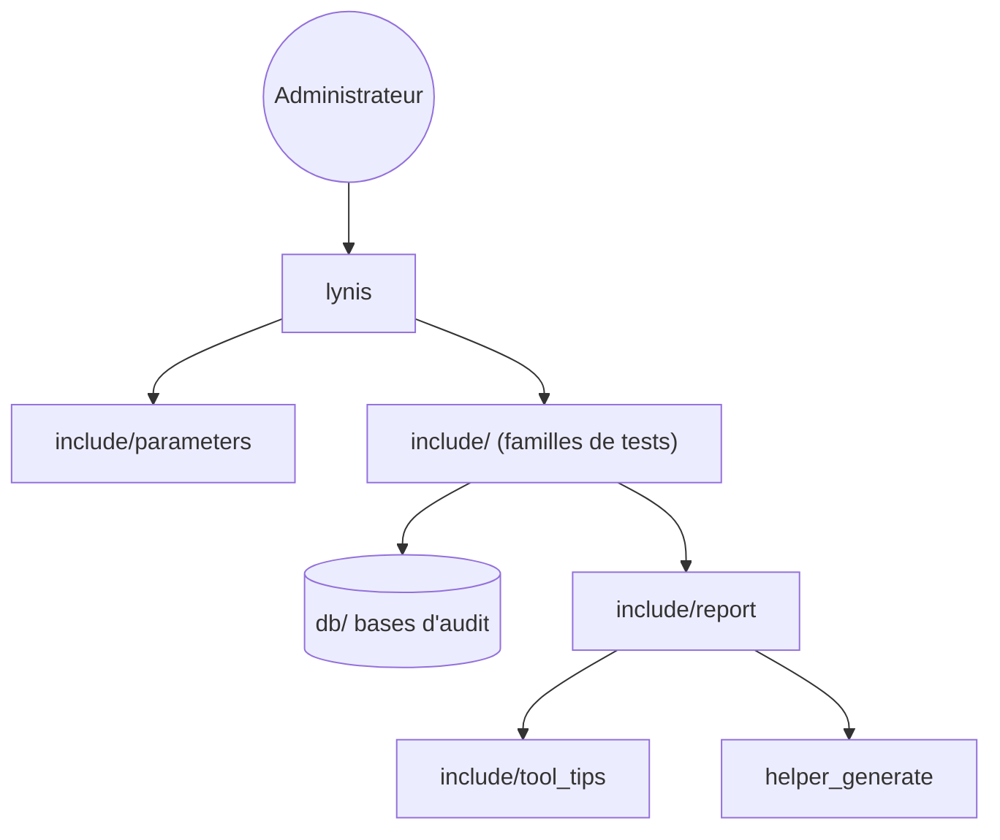

# CISOfy/lynis

> Security auditing and hardening tool for UNIX systems, aimed at administrators and auditors.

## The problem
Knowing whether a Linux, BSD or macOS machine is properly hardened means manually reviewing dozens of settings. Lynis automates this check.

## What it actually does
Lynis runs on the machine itself and launches families of system tests. It produces findings and hardening advice. It also targets compliance (ISO27001, PCI-DSS, HIPAA) and vulnerability detection. A Dockerfile audit mode and a remote scan appear in the directory tree.

## How it is wired


## Trying it
```bash
git clone https://github.com/CISOfy/lynis
cd lynis && ./lynis audit system
```

## Cost and gotchas
Free, no key. To run it as root, the README advises `chown -R 0:0` on the files, otherwise Lynis warns about permissions. The Enterprise version (web interface, support) is paid.

## What it is not
It is not a fixer: it reports and advises, it does not harden on its own. It is not an external network scanner. The exact internal scan-to-report wiring is not verified.

## Alternatives
No alternative named in the README.

## For you
Adopt if you manage Linux servers or images in MLOps: local audit with no installation, useful before going to production.
