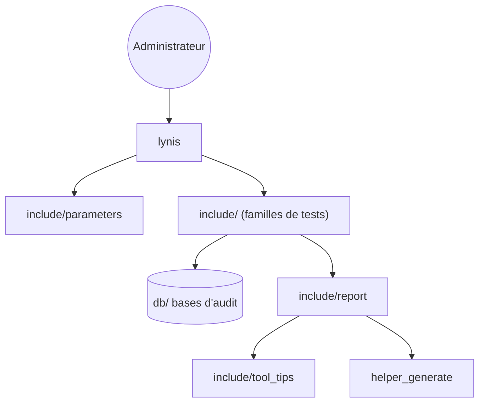

# CISOfy/lynis

> Outil d'audit de sécurité et de durcissement pour systèmes UNIX, destiné aux administrateurs et auditeurs.

## Le problème
Savoir si une machine Linux, BSD ou macOS est correctement durcie demande de passer en revue à la main des dizaines de réglages. Lynis automatise ce contrôle.

## Ce que ça fait vraiment
Lynis tourne sur la machine elle-même et lance des familles de tests système. Il produit des constats et des conseils de durcissement. Il vise aussi la conformité (ISO27001, PCI-DSS, HIPAA) et la détection de vulnérabilités. Un mode d'audit de Dockerfile et un scan distant figurent dans l'arborescence.

## Comment c'est branché


## Essayer
```bash
git clone https://github.com/CISOfy/lynis
cd lynis && ./lynis audit system
```

## Coût et pièges
Gratuit, aucune clé. Pour l'exécuter en root, le README conseille `chown -R 0:0` sur les fichiers, sinon Lynis avertit des permissions. La version Enterprise (interface web, support) est payante.

## Ce que ce n'est pas
Ce n'est pas un correcteur : il signale et conseille, il ne durcit pas tout seul. Ce n'est pas un scanner réseau externe. Le câblage interne exact scan-vers-rapport n'est pas vérifié.

## Alternatives
Aucune alternative nommée dans le README.

## Pour toi
À adopter si tu gères des serveurs ou des images Linux en MLOps : audit local sans installation, utile avant mise en production.

