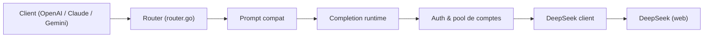

# CJackHwang/ds2api

> Go gateway that exposes DeepSeek's web interface as an OpenAI-, Claude- and Gemini-compatible API.

## The problem
Using the models of the DeepSeek web chat from OpenAI, Anthropic or Gemini clients without going through the official API.

## What it actually does
A Go router translates requests from the three protocols into a text context for DeepSeek (PromptCompat layer), then converts the responses into streams in the client's format. It manages a pool of DeepSeek accounts with a queue, a pure-Go proof of work (PoW), and tool-call detection. A React `/admin` console is used for configuration. On Vercel, the stream goes through a Node relay.

## How it is wired


## Trying it
```bash
cp config.example.json config.json
# éditer config.json (comptes DeepSeek, clés)
git clone https://github.com/CJackHwang/ds2api.git && cd ds2api
go run ./cmd/ds2api
```

## Cost and gotchas
Works by reverse engineering, with your DeepSeek accounts: risk of account blocking or breakage without notice. The repository is archived (last push 2026-05-10).

## What it is not
Not an official client nor a stable service: the README excludes any guarantee and any commercial use without agreement. AGPL-3.0 license.

## Alternatives
No alternative named in the README.

## For you
Ignore: archived repository, based on reverse-engineering a web service (ToS and breakage risk), and AGPL; the official API is safer.
