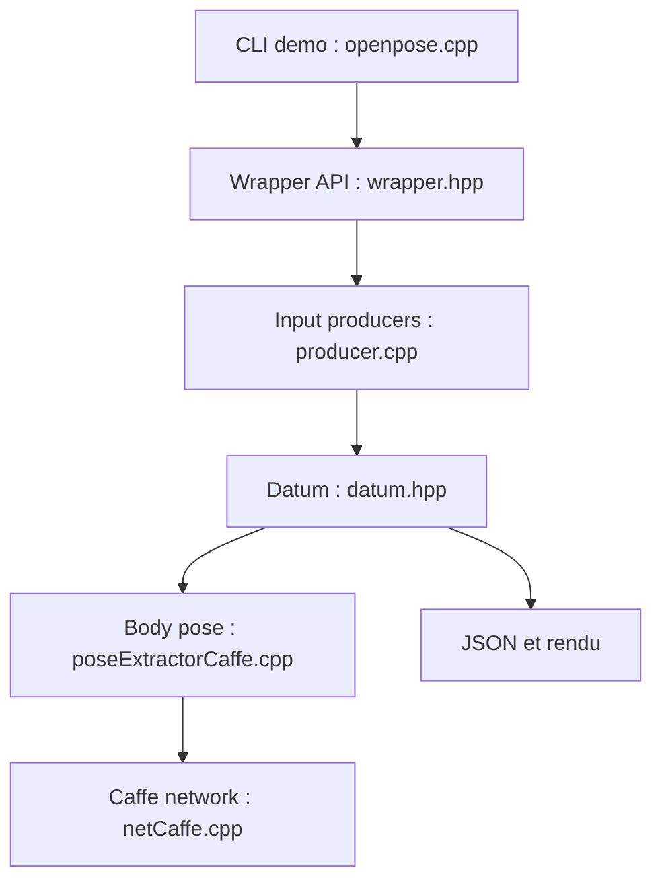

# CMU-Perceptual-Computing-Lab/openpose

> C++ library for real-time detection of body, hand, face and foot keypoints.

## The problem
Estimating the pose of several people in an image or video requires a complete system that is hard to assemble.

## What it actually does
Detects up to 135 keypoints (body, feet, hands, face) in 2D, with 3D reconstruction from several cameras and a calibration tool. Inputs: image, video, webcam, Flir cameras. Outputs: annotated image, JSON, XML, YML. Computation goes through Caffe, with CUDA, OpenCL or CPU only. C++ and Python APIs.

## How it is wired


## Trying it
```bash
./build/examples/openpose/openpose.bin
./build/examples/openpose/openpose.bin --video examples/media/video.avi --face --hand --write_json output_json_folder/
```

## Cost and gotchas
Free, but fast computation requires an Nvidia (CUDA) or AMD (OpenCL) card; a CPU version exists. Built from source with Caffe. A Windows portable build avoids compilation. Last push in August 2024; license not identified by GitHub, the README speaks of research use: to be checked.

## What it is not
Not a recent model: it relies on Caffe. Not free for any commercial use without checking the license.

## Alternatives
- Alpha-Pose: compared to OpenPose's runtime in the README, whose duration grows with the number of people.
- Mask R-CNN: same comparison, duration growing with the number of people.

## For you
Worth watching: a historical reference for human pose, but Caffe, the license to check and the lack of recent updates call for comparing before any serious use.
