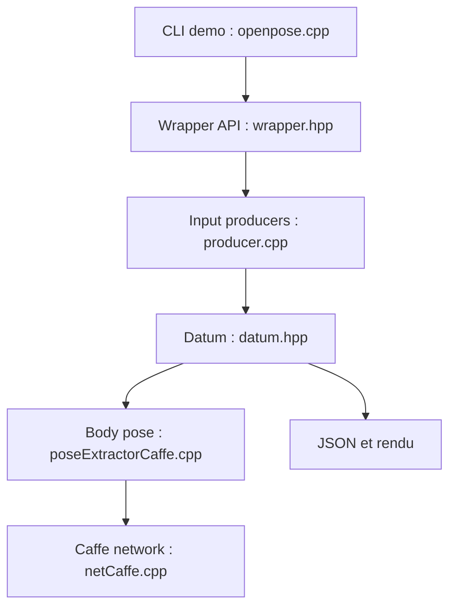

# CMU-Perceptual-Computing-Lab/openpose

> Bibliothèque C++ de détection temps réel de points clés du corps, des mains, du visage et des pieds.

## Le problème
Estimer la posture de plusieurs personnes sur une image ou une vidéo demande un système complet, difficile à rassembler.

## Ce que ça fait vraiment
Détecte jusqu'à 135 points clés (corps, pieds, mains, visage) en 2D, avec reconstruction 3D à partir de plusieurs caméras et outil de calibration. Entrées : image, vidéo, webcam, caméras Flir. Sorties : image annotée, JSON, XML, YML. Le calcul passe par Caffe, avec CUDA, OpenCL ou CPU seul. API C++ et Python.

## Comment c'est branché


## Essayer
```bash
./build/examples/openpose/openpose.bin
./build/examples/openpose/openpose.bin --video examples/media/video.avi --face --hand --write_json output_json_folder/
```

## Coût et pièges
Gratuit, mais le calcul rapide demande une carte Nvidia (CUDA) ou AMD (OpenCL) ; une version CPU existe. Compilation depuis les sources avec Caffe. Un portable Windows évite la compilation. Dernier push en août 2024 ; licence non identifiée par GitHub, le README parle d'usage pour la recherche : à vérifier.

## Ce que ce n'est pas
Pas un modèle récent : il repose sur Caffe. Pas libre pour tout usage commercial sans vérification de la licence.

## Alternatives
- Alpha-Pose : comparé au runtime d'OpenPose dans le README, dont la durée croît avec le nombre de personnes.
- Mask R-CNN : même comparaison, durée croissante avec le nombre de personnes.

## Pour toi
À surveiller : référence historique pour la pose humaine, mais Caffe, la licence à vérifier et l'absence de mise à jour récente incitent à comparer avant tout usage sérieux.

