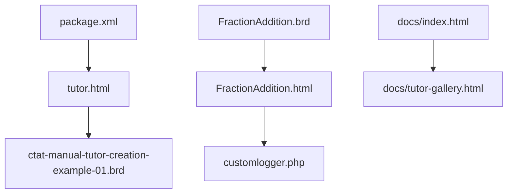

# CMUCTAT/CTAT

> Tools for building intelligent tutors, free for research and teaching.

## The problem
Building a tutor that follows the student's steps requires coding the behaviour by hand.

## What it actually does
The README is a single sentence: it points to the wiki, tools free for academic and research use. Based on the architecture, a tutor pairs an HTML interface with a `.brd` behaviour graph describing the correct steps; the repository provides templates, examples and a documentation site.

## How it is wired


## Trying it
```bash
# aucune commande documentée : lire le wiki du projet
```

## Cost and gotchas
Free for research and academic use; the license is not identified by GitHub, so commercial use needs checking. Very thin README material.

## What it is not
Not a general-purpose AI tool: it is a rule-based tutor environment, not machine learning.

## Alternatives
No alternative named in the README.

## For you
Ignore: educational domain unrelated to your work, and license to be clarified.
