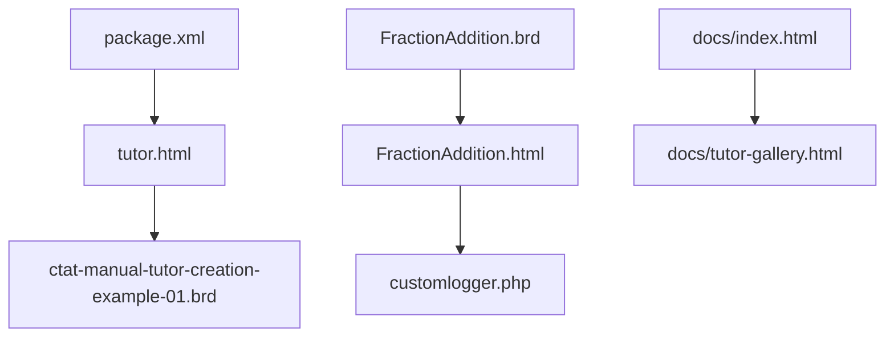

# CMUCTAT/CTAT

> Outils de création de tuteurs intelligents, gratuits pour la recherche et l'enseignement.

## Le problème
Construire un tuteur qui suit les étapes de l'élève demande de coder le comportement à la main.

## Ce que ça fait vraiment
Le README tient en une phrase : il renvoie au wiki, outils gratuits pour usage académique et recherche. D'après l'architecture, un tuteur associe une interface HTML à un graphe de comportement `.brd` décrivant les étapes correctes ; le dépôt fournit gabarits, exemples et un site de documentation.

## Comment c'est branché


## Essayer
```bash
# aucune commande documentée : lire le wiki du projet
```

## Coût et pièges
Gratuit pour la recherche et l'académique ; la licence n'est pas identifiée par GitHub, donc l'usage commercial est à vérifier. Matière du README très mince.

## Ce que ce n'est pas
Pas un outil généraliste d'IA : c'est un environnement de tuteurs à règles, pas d'apprentissage automatique.

## Alternatives
Aucune alternative nommée dans le README.

## Pour toi
Ignorer : domaine éducatif sans lien avec ton travail, et licence à clarifier.

