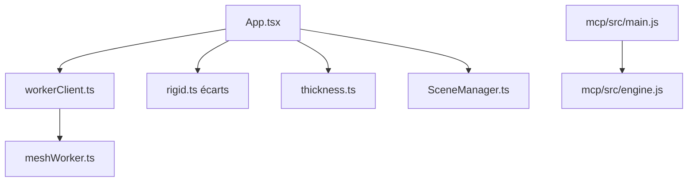

# CNCKitchen/ScanRuler

> Web application for checking 3D scans: measurements, deviations from CAD, wall thickness, reverse engineering.

## The problem
Comparing a 3D scan to its theoretical part requires heavy, expensive metrology software.

## What it actually does
Fits spheres, cylinders and planes to the scan, measures distances and angles, maps the deviation from the CAD model and the wall thickness, measures flat scans, and exports to STEP, SVG, DXF. A reverse-engineering tool builds a solid body; an AI agent can drive the application via MCP. Everything runs in the browser.

## How it is wired


## Trying it
```bash
npm install
npm run dev
claude mcp add --scope user scanruler -- npx -y scanruler-mcp@latest
```

## Cost and gotchas
Free online; AGPL with commercial licenses possible. With a connected agent, the measurements go to the model provider. A full reverse engineering takes time: 106 minutes and 284 tool calls for one part.

## What it is not
Not a full CAD program. The scan share in the tolerance measures proximity to the scan, not the real fit. Freeform remains the weakest case.

## Alternatives
- GOM Inspect and PC-DMIS: cited as metrology references, whose logic the tool follows.

## For you
Watch: a concrete example of an MCP agent driving a business application, with honest failure figures, but outside your direct field.
