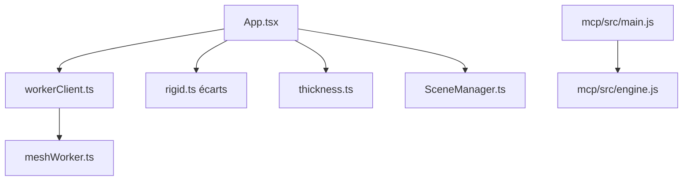

# CNCKitchen/ScanRuler

> Application web de contrôle de scans 3D : mesures, écarts à la CAO, épaisseur de paroi, rétro-ingénierie.

## Le problème
Comparer un scan 3D à sa pièce théorique exige des logiciels de métrologie lourds et coûteux.

## Ce que ça fait vraiment
Ajuste des sphères, cylindres et plans sur le scan, mesure distances et angles, cartographie l'écart au modèle CAO et l'épaisseur de paroi, mesure des scans à plat, exporte en STEP, SVG, DXF. Un outil de rétro-ingénierie construit un corps solide ; un agent IA peut piloter l'application via MCP. Tout tourne dans le navigateur.

## Comment c'est branché


## Essayer
```bash
npm install
npm run dev
claude mcp add --scope user scanruler -- npx -y scanruler-mcp@latest
```

## Coût et pièges
Gratuit en ligne ; AGPL avec licences commerciales possibles. Avec un agent connecté, les mesures partent chez le fournisseur du modèle. Une rétro-ingénierie complète prend du temps : 106 minutes et 284 appels d'outils pour une pièce.

## Ce que ce n'est pas
Pas un logiciel de CAO complet. La part de scan dans la tolérance mesure la proximité au scan, pas l'ajustement réel. Le freeform reste le cas le plus faible.

## Alternatives
- GOM Inspect et PC-DMIS : cités comme références de métrologie, dont l'outil reprend la logique.

## Pour toi
Surveiller : exemple concret d'agent MCP qui pilote une application métier avec des chiffres d'échec honnêtes, mais hors de ton domaine direct.

