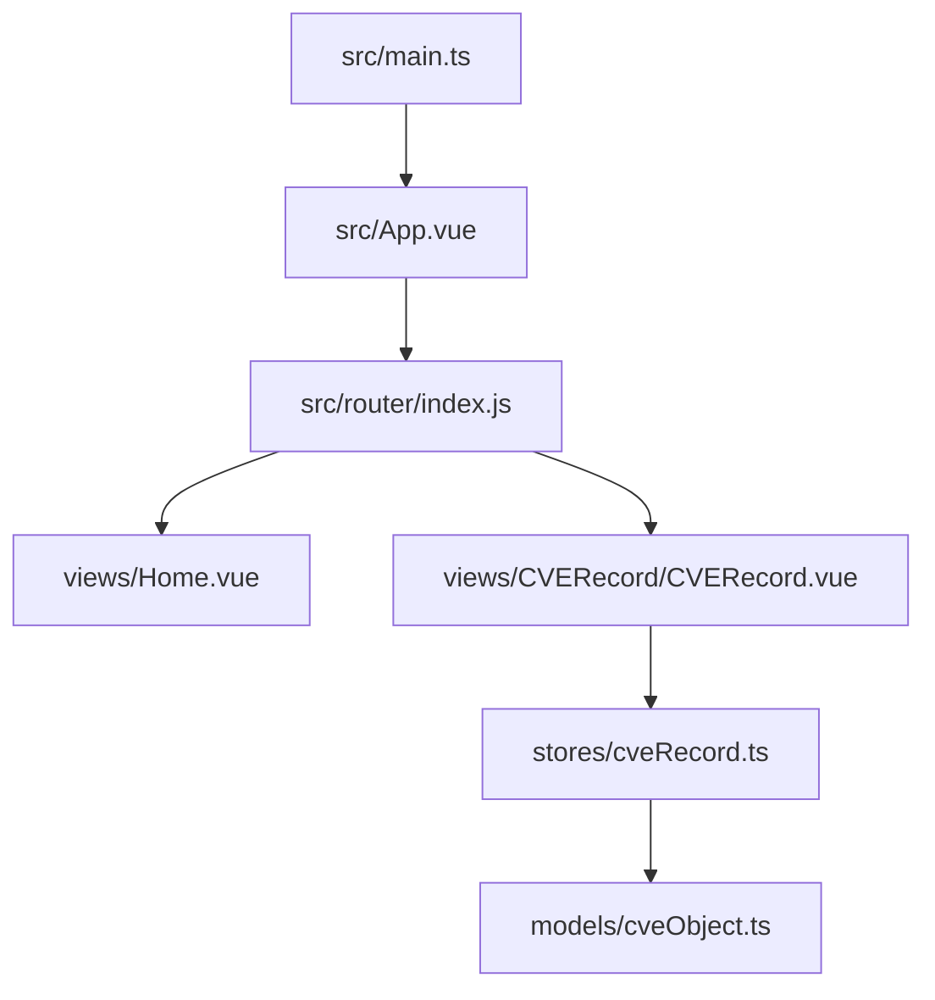

# CVEProject/cve-website

> Vue 3 source code of the CVE program website, for site contributors.

## The problem
The README is the default Vue/Vite template and does not explain what the site does.

## What it actually does
Based on the architecture: `main.ts` starts the Vue application, the router displays the home page, the page of a CVE record and search results. Stores fetch the records, typed by models. The README does not say so: undocumented.

## How it is wired


## Trying it
```bash
npm install
npm run dev
npm run build
npm run lint
```

## Cost and gotchas
Free. No license declared: reuse of the code is legally uncertain.

## What it is not
Not a vulnerability database, only the site that displays them. Not an offensive tool.

## Alternatives
No alternative named in the README.

## For you
Ignore: a showcase site, with no license, with no reusable value for data work.
