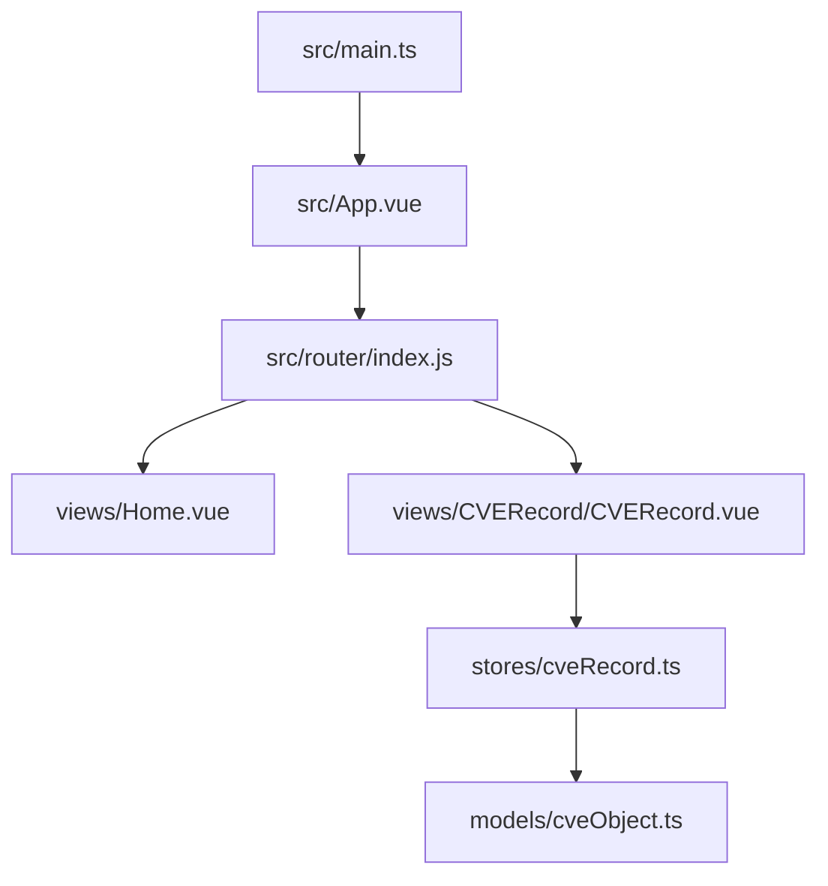

# CVEProject/cve-website

> Code source Vue 3 du site du programme CVE, pour contributeurs au site.

## Le problème
Le README est le modèle Vue/Vite par défaut et n'explique pas ce que fait le site.

## Ce que ça fait vraiment
D'après l'architecture : `main.ts` démarre l'application Vue, le routeur affiche l'accueil, la fiche d'un enregistrement CVE et les résultats de recherche. Des stores récupèrent les enregistrements, typés par des modèles. Le README ne le dit pas : non documenté.

## Comment c'est branché


## Essayer
```bash
npm install
npm run dev
npm run build
npm run lint
```

## Coût et pièges
Gratuit. Aucune licence déclarée : réutilisation du code juridiquement incertaine.

## Ce que ce n'est pas
Pas une base de données de vulnérabilités, seulement le site qui les affiche. Pas un outil offensif.

## Alternatives
Aucune alternative nommée dans le README.

## Pour toi
Ignorer : un site vitrine, sans licence, sans valeur réutilisable pour du travail data.

