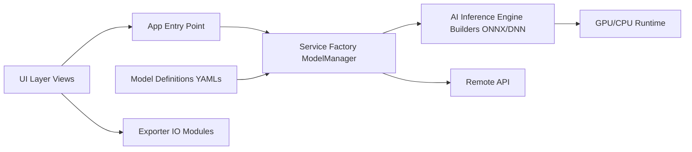

# CVHub520/X-AnyLabeling

> Desktop AI-assisted data annotation application: images, video, text, point clouds.

## The problem
Annotating vision datasets by hand is slow; plugging pre-annotation models into a labeling tool requires code.

## What it actually does
Tools: polygons, boxes, oriented boxes, cuboids, masks, points, OCR/KIE, tags, magic wand, 3D point clouds.
Pre-annotation with built-in models (YOLO, SAM 1/2/3, Grounding DINO, PP-OCR, Florence2, Qwen3-VL…).
Local inference (ONNX Runtime, TensorRT, OpenCV DNN) or remote (vLLM, SGLang, X-AnyLabeling-Server).
Import/export COCO, VOC, YOLO, DOTA, MOT, PPOCR, ShareGPT; Windows, Linux, macOS.

## How it is wired

## Trying it
No command in the README (points to the "Installation & Quickstart" docs).

## Cost and gotchas
Free, GPL-3.0 (watch out when redistributing modified versions). GPU recommended for large models; cloud VLMs (Gemini, ChatGPT) are at your expense. CLA required to contribute.

## What it is not
Not a collaborative multi-annotator web platform: it is a desktop application. Not a training tool (only an Ultralytics example is provided).

## Alternatives
None named in the README.

## For you
Adopt it for your vision projects: SAM/YOLO/Grounding DINO pre-annotation and standard exports save days when building a dataset.
