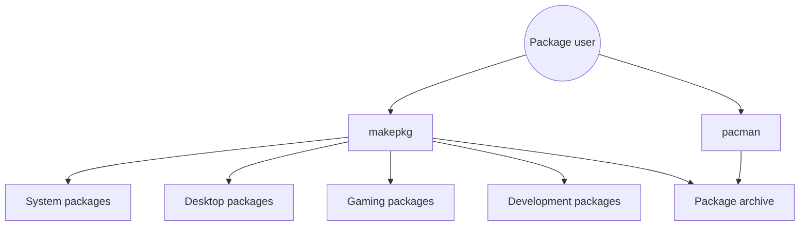

# CachyOS/CachyOS-PKGBUILDS

> CachyOS PKGBUILD recipes to build and install packages on an Arch Linux-derived system.

## The problem
On an Arch distribution, getting CachyOS-specific packages (kernel, drivers, gaming tools) requires knowing their build recipes.

## What it actually does
The repository groups recipe folders, one per package. You enter a folder, `makepkg` builds the archive, `pacman -U` installs it. The families cover the base system, the desktop, gaming and handheld, and development tools. The README describes nothing more.

## How it is wired
Diagram based on the code diagram.


## Trying it
```bash
git clone https://github.com/cachyos/cachyos-pkgbuilds.git
cd cachyos-pkgbuilds/
makepkg -si
sudo pacman -U .pkg.tar.zst
```

## Cost and gotchas
Free. You need git, make, gcc, binutils and fakeroot on an Arch system. No license is declared in the repository.

## What it is not
It is not an application but a set of recipes. It is useless outside an Arch-based system. The README command is generic: you have to pick the folder of the package you want.

## Alternatives
No alternative named in the README.

## For you
Ignore: only useful if you use CachyOS or Arch for a gaming machine, unrelated to data or MLOps work.
