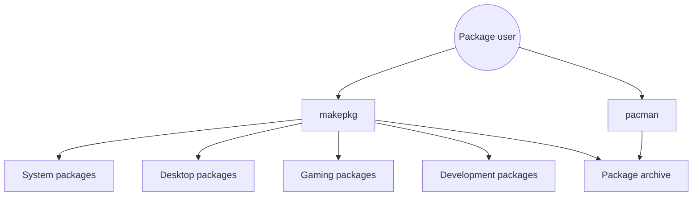

# CachyOS/CachyOS-PKGBUILDS

> Recettes PKGBUILD de CachyOS pour compiler et installer des paquets sur un système dérivé d'Arch Linux.

## Le problème
Sur une distribution Arch, récupérer les paquets spécifiques de CachyOS (noyau, pilotes, outils de jeu) demande de connaître leurs recettes de construction.

## Ce que ça fait vraiment
Le dépôt regroupe des dossiers de recettes, un par paquet. On entre dans un dossier, `makepkg` construit l'archive, `pacman -U` l'installe. Les familles couvrent le système de base, le bureau, le jeu et portable, et les outils de développement. Le README ne décrit rien de plus.

## Comment c'est branché
Schéma d'après le diagramme du code.


## Essayer
```bash
git clone https://github.com/cachyos/cachyos-pkgbuilds.git
cd cachyos-pkgbuilds/
makepkg -si
sudo pacman -U .pkg.tar.zst
```

## Coût et pièges
Gratuit. Il faut git, make, gcc, binutils et fakeroot sur un système Arch. Aucune licence n'est déclarée dans le dépôt.

## Ce que ce n'est pas
Ce n'est pas une application mais un lot de recettes. Il ne sert à rien hors d'un système basé sur Arch. La commande du README est générique : il faut choisir le dossier du paquet voulu.

## Alternatives
Aucune alternative nommée dans le README.

## Pour toi
À ignorer : utile seulement si tu utilises CachyOS ou Arch pour un poste de jeu, sans lien avec le travail data ou MLOps.

