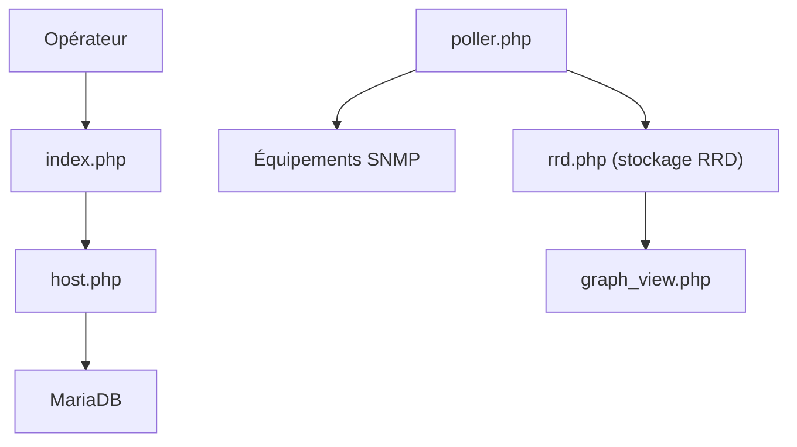

# Cacti/cacti

> PHP network monitoring and time-series graphing platform, built on RRDtool.

## The problem
Collect and visualize measurements from network devices and servers on a regular basis.

## What it actually does
A poller (PHP or Spine in C) queries via SNMP, scripts or databases, stores results in RRD files and displays graphs from templates. Automatic discovery, remote collectors, plugins, role-based permissions, CSV export.

## How it is wired


## Trying it
```bash
git clone https://github.com/Cacti/cacti.git
cd cacti
composer install
npm ci
sudo -u cacti php -q cli/upgrade_database.php --forcever=`cat include/cacti_version`
```

## Cost and gotchas
Free, GPL-2.0. Requires PHP 8.2+, MariaDB or MySQL, RRDtool and Net-SNMP, plus a web server; the develop branch is at 1.3.x.

## What it is not
Not an application monitoring or model observability tool: classic network monitoring.

## Alternatives
No alternative named in the README.

## For you
Ignore: network monitoring built on RRDtool, far from modern MLOps observability.
