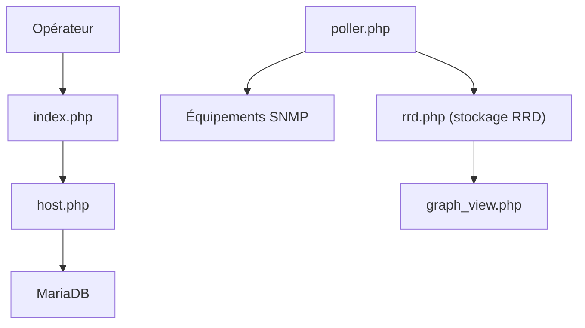

# Cacti/cacti

> Plateforme PHP de supervision réseau et de graphes de séries temporelles, fondée sur RRDtool.

## Le problème
Collecter et visualiser les mesures d'équipements réseau et de serveurs de façon régulière.

## Ce que ça fait vraiment
Un poller (PHP ou Spine en C) interroge par SNMP, scripts ou bases, stocke dans des fichiers RRD et affiche des graphes à partir de modèles. Découverte automatique, collecteurs distants, plugins, droits par rôle, export CSV.

## Comment c'est branché


## Essayer
```bash
git clone https://github.com/Cacti/cacti.git
cd cacti
composer install
npm ci
sudo -u cacti php -q cli/upgrade_database.php --forcever=`cat include/cacti_version`
```

## Coût et pièges
Gratuit, GPL-2.0. Demande PHP 8.2+, MariaDB ou MySQL, RRDtool et Net-SNMP, plus un serveur web ; la branche develop est en 1.3.x.

## Ce que ce n'est pas
Pas un outil de monitoring d'application ni d'observabilité de modèles : de la supervision réseau classique.

## Alternatives
Aucune alternative nommée dans le README.

## Pour toi
À ignorer : supervision réseau sur RRDtool, éloignée de l'observabilité MLOps moderne.

