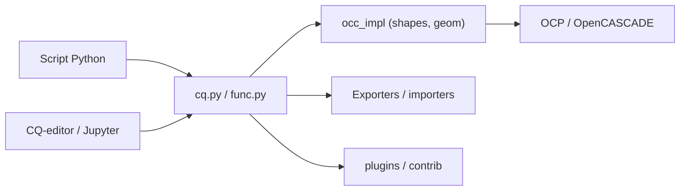

# CadQuery/cadquery

> Python module for describing parametric 3D CAD models by script, for engineers and developers.

## The problem
GUI-based CAD is hard to version and parameterize; a scripted model can be reread, tested and regenerated.

## What it actually does
A high-level Python API (cq.py, func.py, fig.py, sketch, assemblies) drives the OpenCASCADE kernel through the OCP bindings. Exports to STEP, DXF, STL, VRML, AMF, 3MF; built-in visualization (raster and VTK), Jupyter, the CQ-editor editor. Plugins and contributions as extensions.

## How it is wired


## Trying it
```bash
mamba install -c conda-forge cadquery
pip install cadquery
python3 -c "from cadquery.func import box, fillet; from cadquery.vis import show; b=box(1,1,1); show(fillet(b, b.edges('|Z'), 0.1))"
```

## Cost and gotchas
Free. The README says conda installation is better supported than pip; pip is limited to Python 3.9 to 3.12 and to certain Linux distributions. License "present but not identified" by GitHub: worth reading.

## What it is not
Not a graphical CAD application: the library is designed without an interface. Not a simulation tool.

## Alternatives
No alternative named in the README (CQ-editor and OCP are companions, not competitors).

## For you
Worth watching: useful for generating parametric geometry in a scripted pipeline, outside the data/AI core.
