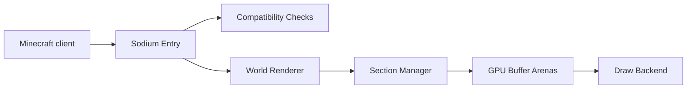

# CaffeineMC/sodium

> Client-side Minecraft rendering optimization mod, for players who want more frames per second.

## The problem
Minecraft's rendering engine is slow and causes stutter on many machines.

## What it actually does
It replaces chunk rendering: world sections are updated, culled and rebuilt asynchronously, mesh data is sent to the GPU through buffer arenas, with lighting pipelines and video settings. It works with Fabric and NeoForge (since 0.6.0). Official support for OpenGL 4.5 or higher; OpenGL translation layers are not supported.

## How it is wired


## Trying it
```bash
gradle build
./gradlew build
```

## Cost and gotchas
Free. Building requires OpenJDK 21 and Gradle 8.10. License present but not identified by GitHub. Nightly builds are unsupported.

## What it is not
Not a tool for other games, nor a solution for old GPUs or compatibility layers.

## Alternatives
No alternative named in the README.

## For you
Ignore: a game mod, unrelated to data/AI/MLOps.
