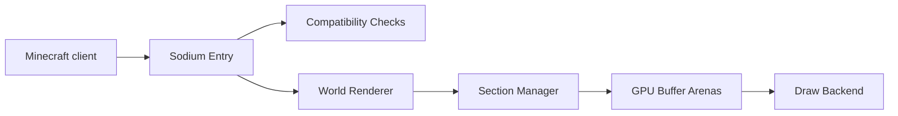

# CaffeineMC/sodium

> Mod d'optimisation du rendu Minecraft côté client, pour joueurs qui veulent plus d'images par seconde.

## Le problème
Le moteur de rendu de Minecraft est lent et provoque des saccades sur beaucoup de machines.

## Ce que ça fait vraiment
Il remplace le rendu des chunks : sections de monde mises à jour, élaguées et reconstruites en asynchrone, données de maillage envoyées au GPU via des arènes de tampons, avec pipelines d'éclairage et réglages vidéo. Il fonctionne avec Fabric et NeoForge (depuis la 0.6.0). Support officiel pour OpenGL 4.5 ou plus ; les couches de traduction OpenGL ne sont pas prises en charge.

## Comment c'est branché


## Essayer
```bash
gradle build
./gradlew build
```

## Coût et pièges
Gratuit. Compiler demande OpenJDK 21 et Gradle 8.10. Licence présente mais non identifiée par GitHub. Versions nightly sans support.

## Ce que ce n'est pas
Pas un outil pour d'autres jeux, ni une solution pour les GPU anciens ou les couches de compatibilité.

## Alternatives
Aucune alternative nommée dans le README.

## Pour toi
À ignorer : mod de jeu, sans rapport avec data/IA/MLOps.

