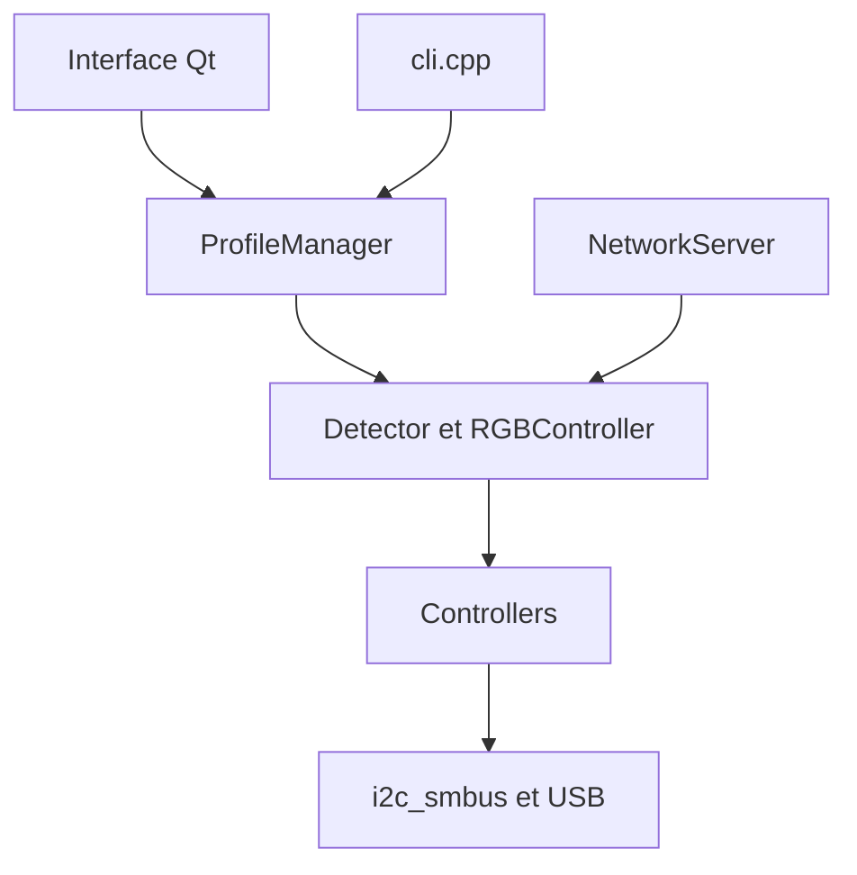

# CalcProgrammer1/OpenRGB

> Single application to control the RGB lighting of hardware from different brands, without vendor software.

## The problem
Each manufacturer imposes its own RGB software, often Windows only, sometimes with an online account.

## What it actually does
OpenRGB sets colors and effects on a wide range of hardware, saves profiles, offers a CLI and a network SDK for other software, and can run as a headless server or synchronize several PCs. Per-device controllers rely on reverse-engineered protocols, through libusb, hidapi or SMBus. Plugins add features.

## How it is wired

## Trying it
No documented command: download the binaries from openrgb.org or the releases, then configure USB and SMBus access.

## Cost and gotchas
Free. The README warns that hardware has already been damaged by misunderstood protocols. udev rules must be installed for AppImage and Flatpak. On Windows, Visual C++ 2019 runtime.

## What it is not
Not an official vendor tool. No guarantee against hardware damage.

## Alternatives
No alternative named in the README as a replacement.

## For you
Ignore: a PC lighting utility, unrelated to your data or AI work.
